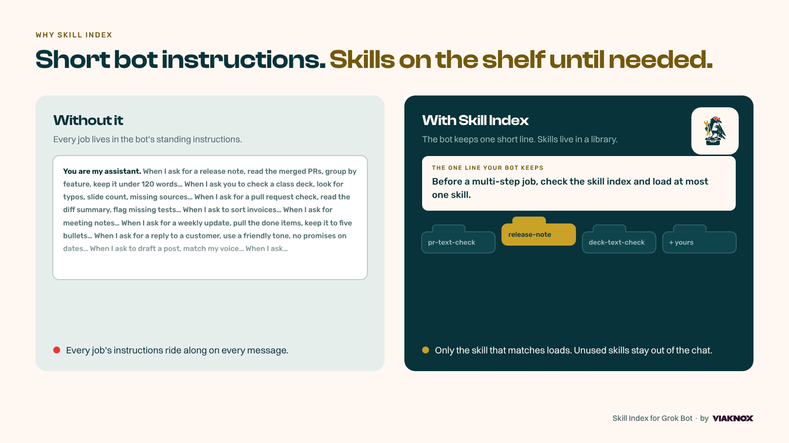

<p align="center">
  
</p>

<h1 align="center">Tune-Up for Grok Bot</h1>

<p align="center"><b>Ask for the job. It finds the right skill. Even one you don't have yet.</b><br/>by Viaknox™</p>

<p align="center">
  
  
  
</p>

<p align="center">
  A bot that tunes up your other <b>Grok bots</b>, with a built-in skill index. Ask for the job in plain English. The bot picks up one skill. Your bot instructions stay short.
</p>

## TL;DR

- **What it is:** a bot that tunes up your other Grok bots, plus a skill index they share.
- **Problem 1:** bots drift and nobody checks them. Tune-Up reviews them and suggests small fixes you approve.
- **Problem 2:** bot instructions bloat. The skill index loads the one skill a job needs, so instructions stay short and tokens stay low.
- **Get it:** install the plugin, then tell any Grok bot "set up Tune-Up".

## Contents

- [What is Tune-Up?](#what-is-tune-up)
  - [The problems it solves](#the-problems-it-solves)
  - [The Tune-Up bot](#the-tune-up-bot)
  - [The skill index](#the-skill-index)
- [What's the outcome of using it?](#whats-the-outcome-of-using-it)
- [How can you use it with Grok Bot?](#how-can-you-use-it-with-grok-bot)
- [How can you install it?](#how-can-you-install-it)
- [FAQs](#faqs)
- [License](#license)
- [Trademarks](#trademarks)

## What is Tune-Up?

Tune-Up is a bot that tunes up your other Grok bots. It comes with a skill index, so your bots load the right skill only when they need it, instead of carrying huge instructions.

It comes as one plugin with two parts:

- **The Tune-Up bot** checks how your other bots perform and suggests small, clear fixes.
- **The skill index** keeps saved skills out of your bots' instructions and loads one only when the job needs it.

### The problems it solves

**Bots drift, and nobody checks them.** They give vague or wrong answers, say work is done when it isn't, ask questions they could have answered themselves, and run routines that waste money. Most people never go back to fix them. The Tune-Up bot reviews your bots against clear standards, turns every miss into a test, and suggests small fixes. You see each fix before it's applied.

**Bot instructions bloat.** Every job gets pasted into a bot's standing instructions, so every message carries all of it. That costs more tokens, makes the bot slower and muddier, and leaves you editing one long file forever. The skill index keeps each job in its own skill, and the bot loads only the one it needs. If no skill fits, it finds one in the skill marketplaces and adds it once you say yes.

**They work together.** Tune-Up spots long, repeated jobs in a bot's instructions and moves them into the skill index, so each fix makes the other one better.

### The Tune-Up bot

<p align="center"></p>

Tune-Up is a ready-made Grok bot, titled "Bot that tunes up other bots".

- It helps you design new bots with a short interview.
- It turns every miss into a check, and calls it fixed only when the bot passes.
- It moves long, repeated procedures out of bot instructions and into the skill index.
- It shows you every change first. It never changes a bot's purpose or deletes a bot without your yes.

See the [Tune-Up guide](tune-up/README.md) for what it will and won't do, and what your first week looks like.

### The skill index

Tune-Up keeps a skill index. A skill is a saved way to do one job, such as writing a release note or checking a pull request. Each skill lives in its own file instead of being pasted into a bot's standing instructions.

The bot only sees a short label for each skill: its name and when to use it. The full instructions load only when you ask for that job. Tune-Up also helps the bot find new skills in public skill marketplaces and add them to your local library, but only when you say so.

| Piece | What it is for |
| --- | --- |
| [Set up Tune-Up](skills/set-up-tune-up/SKILL.md) | Creates the Tune-Up bot, which checks and improves your other bots, after you confirm. |
| [Tune-Up instructions](tune-up/INSTRUCTIONS.md) | The full, paste-ready instructions for the Tune-Up bot. |
| [Skill index](skills/skill-index/SKILL.md) | How a bot picks one skill, or none. |
| [Find a skill](skills/find-skill/SKILL.md) | Searches marketplaces when your library has no match, and asks before adding. |
| [Import a skill](skills/import-agent-skill/SKILL.md) | Adds a skill you approved into your local library. |
| [Always-on line](rules/skill-index.mdc) | The one short rule the bot keeps in mind. |
| [Starter skills](starters/file-index/index.md) | Three examples: release note, class deck check, pull request check. |
| [Marketplaces](marketplaces.json) | Six default places Tune-Up can search. You can add your own. |

## What's the outcome of using it?

<p align="center"></p>

- **Bots that get better over time.** Tune-Up turns each miss into a check and suggests small fixes, one at a time, each shown to you first.
- **Shorter bot instructions.** Your bots keep one line about the skill index instead of a long file covering every job.
- **Fewer tokens.** Skills you aren't using stay out of the conversation, so each chat is lighter and cheaper.
- **More consistent work.** The same job is done the same way every time, because the bot follows the saved skill.
- **One library for all your bots.** Every Grok bot that has the plugin can use the same skills.
- **You stay in control.** Nothing from a marketplace is added until you say add, the bot never picks between two matching skills for you, and Tune-Up applies no change you haven't seen.

## How can you use it with Grok Bot?

**Get the Tune-Up bot.** Tell any Grok bot "set up Tune-Up". It explains what it will do, asks you to confirm, then asks four short questions (which bots, what must never change, suggest only or apply after yes, how often). You can also create a bot yourself and paste the [Tune-Up instructions](tune-up/INSTRUCTIONS.md).

**Ask for the job.** Just ask for the work in plain English. You don't need to name the skill.

| You say | What happens |
| --- | --- |
| "Write a short release note." | One skill matches, so the bot uses it. |
| "Check this class deck and this pull request." | Two skills fit. The bot names both and asks which you want. |
| "Is there a skill for organizing invoices?" | The bot searches your marketplaces and shows matches. Nothing is added until you say add. |
| "Search awesomeskill.ai for a meeting-notes skill." | The bot searches that site, then asks whether it should join your default search list. |

To set up any bot to use the skill index:

1. Install the plugin (below).
2. In that bot's instructions, keep one short line: "Before a multi-step job, check the skill index and load at most one skill."
3. Ask the bot for a job. If a saved skill matches, it uses it.
4. If nothing matches, the bot searches the default marketplaces and asks if it should add one. Say add, and the skill is ready from then on.

A skill never overrides who the bot is. The bot's own rules still win.

## How can you install it?

**Option 1: ask your Grok bot.** Tell it: "Install the Tune-Up plugin from https://github.com/viaknox/tune-up into `~/.cursor/plugins/local/tune-up`." Then reload.

**Option 2: install it yourself.**

```bash
git clone https://github.com/viaknox/tune-up.git ~/.cursor/plugins/local/tune-up
```

Then reload the window and test it by asking a Grok bot: "Write a short release note." To add the bot, say "set up Tune-Up".

The plugin ships with an empty SQLite library (`library.sqlite`) and the default marketplace list. Only skills you add are written to the library.

To update later, run `git pull` inside that folder.

## FAQs

**Do I need to name the skill when I ask?**
No. Ask for the job in plain English and the bot finds the matching skill.

**What if two skills match?**
The bot names both and asks you to pick. It won't guess.

**Does connecting a marketplace download all its skills?**
No. Marketplaces are only searched. Results are shown to you and not saved. Only a skill you choose to add is written to your library.

**Can I add my own marketplaces?**
Yes. Name a site in chat and the bot will search it and ask whether to add it to the default list, or edit `marketplaces.json` yourself.

**What if the same skill is listed in several marketplaces?**
It shows up as one entry with a link for each place. A different skill with a similar name stays its own entry.

**Will a skill change my bot's personality or rules?**
No. A skill only covers how to do one job. The bot's own instructions always win.

**Can I write my own skills?**
Yes. A skill is a folder with a `SKILL.md` file. Look at the [starter skills](starters/file-index/index.md) for examples, then ask your bot to import yours.

**Can I get the Tune-Up bot automatically?**
Yes. Install the plugin, tell any Grok bot "set up Tune-Up", and confirm. A skill can't create a bot without your OK.

**Will Tune-Up change my bots without asking?**
No. It shows every change first, unless you choose apply-after-yes, and even then it applies a change only after you say yes to it. It never changes a bot's purpose or deletes a bot.

**I installed it before it was called Tune-Up. What do I do?**
Rename the plugin folder to `~/.cursor/plugins/local/tune-up` (this keeps any skills you added), run `git pull` inside it, and reload. The old GitHub link redirects here. If you already set up the Tune-Up bot, update its instructions from [tune-up/INSTRUCTIONS.md](tune-up/INSTRUCTIONS.md), because the library path changed.

**Does it cost anything?**
No. It's free and open source under the MIT license.

**Is this an official Grok Bot product?**
No. It's built by Viaknox for Grok Bot users and isn't affiliated with or endorsed by SpaceXAI, xAI, or X.

## License

MIT. See [LICENSE](LICENSE).

## Trademarks

Viaknox is a trademark of Viaknox Holding LLC. Tune-Up is a product name of Viaknox Holding LLC. The MIT license covers the code and text, not the Viaknox or Tune-Up names or marks. See [TRADEMARK.md](TRADEMARK.md). Brand files and usage rules are in [brand/BRAND.md](brand/BRAND.md).

Grok and Grok Bot are SpaceXAI (xAI) products, named here only to say what this plugin is built for. Not affiliated with or endorsed by SpaceXAI, xAI, or X.
